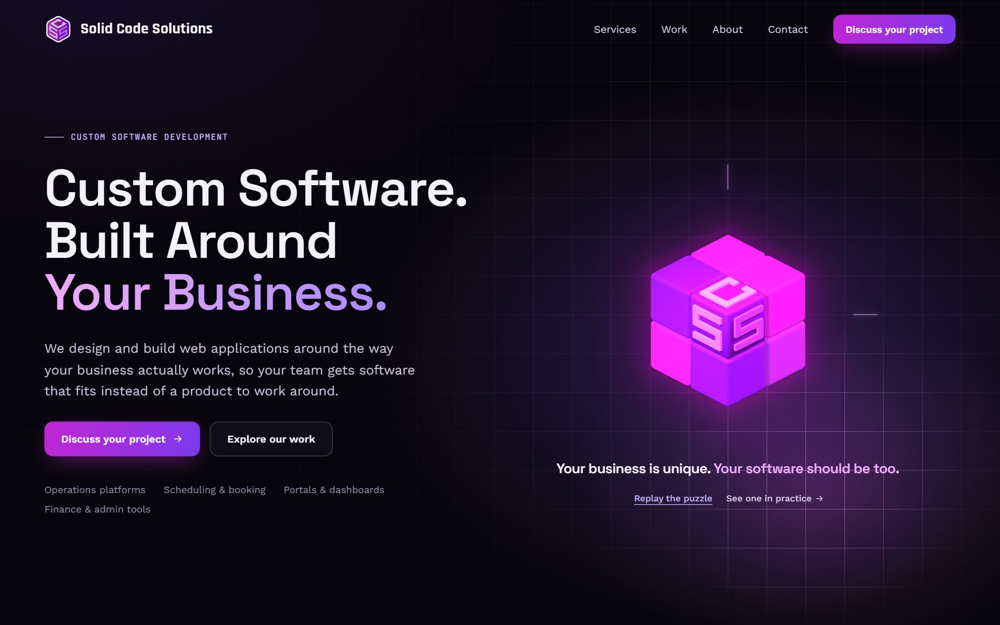
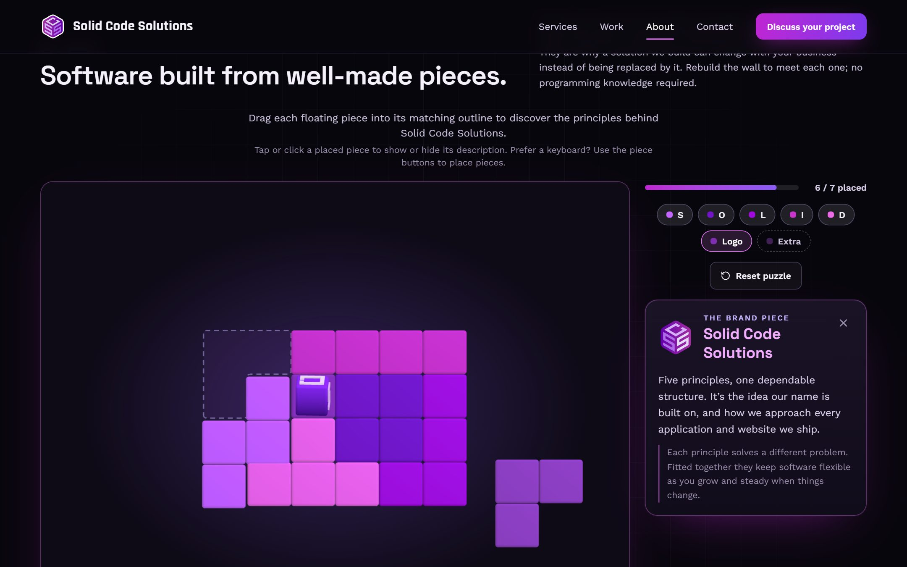
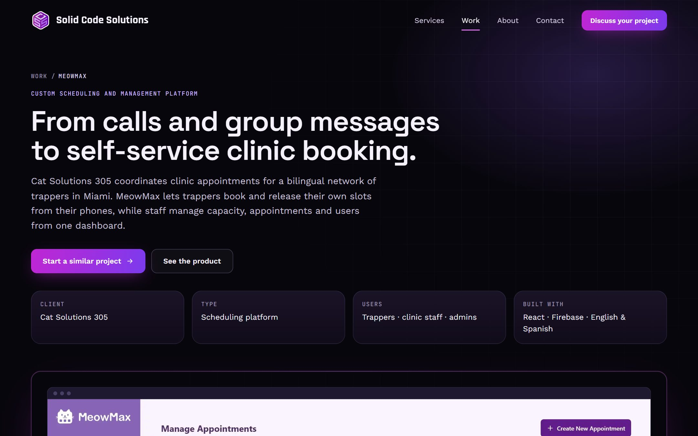
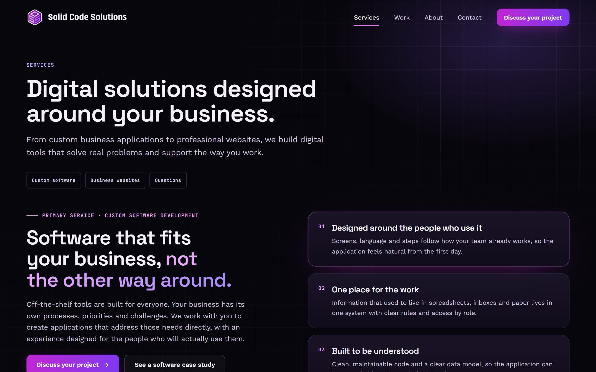
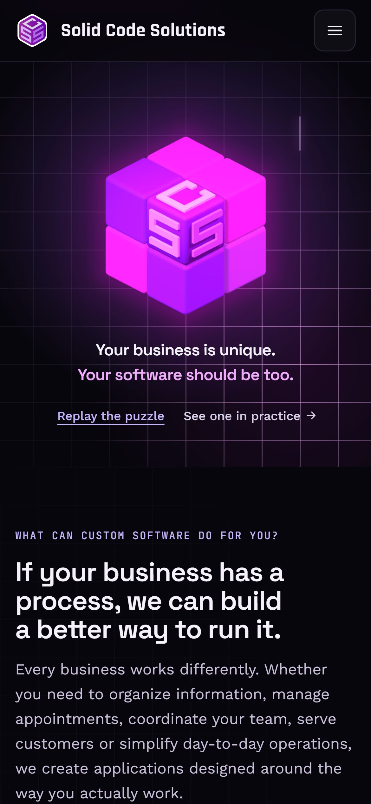

<div align="center">


# Solid Code Solutions

**Custom software, built around your business.**

The website of [Solid Code Solutions LLC](https://solidcodesolutionsllc.com), a studio that designs and builds custom web applications for businesses, plus the professional websites that go with them.

[**Visit the live site →**](https://solidcodesolutionsllc.com) &nbsp;·&nbsp; [Case studies](https://solidcodesolutionsllc.com/work) &nbsp;·&nbsp; [Start a project](https://solidcodesolutionsllc.com/contact)




</div>

## About this project

This repository is the company's own website, and it doubles as a working sample of how we build software. It is held to the same standard we deliver to clients:

- **Fully typed and tested**, with unit, component, server and end-to-end tests.
- **Accessible**, with an automated accessibility audit on every page.
- **Fast**, with compressed 3D models and self-hosted fonts.
- **Privacy-respecting**, with no tracking until a visitor agrees to it.

The site presents two services. Custom software development is the core of the business, and business websites are the secondary offering. Each case study walks through a real client project, from the problem to what was built and how it is used today.

## Highlights

<table>
  <tr>
    <td width="50%" valign="top">
      
      <p><strong>Interactive SOLID puzzle.</strong> On the About page, visitors drag seven 3D pieces into a wall to learn the SOLID design principles behind the studio's work. Each placed piece explains one principle. Finishing the wall plays a retro arcade victory.</p>
    </td>
    <td width="50%" valign="top">
      
      <p><strong>Case studies that tell the whole story.</strong> Each project goes from the problem to the approach and what was built. A screen-by-screen product walkthrough supports swipe, arrow keys and a full-screen view. "Start a similar project" pre-fills the contact form.</p>
    </td>
  </tr>
  <tr>
    <td width="50%" valign="top">
      
      <p><strong>A clear, typed content model.</strong> Services, case studies, FAQs and screenshots live in typed data files. Content tests reject unsourced statistics and leftover drafting placeholders before they reach production.</p>
    </td>
    <td width="50%" valign="top" align="center">
      
      <p align="left"><strong>Designed for every screen.</strong> The layout adapts across phone, tablet and desktop. The hero puzzle works by touch. Anyone who prefers reduced motion gets a calm, static version.</p>
    </td>
  </tr>
</table>

### What's under the hood

- **A playable hero.** The homepage opens with a 3D cube puzzle built in React Three Fiber. When it's solved, a circuit animation runs across the grid, and a spotlight follows the pointer. The 3D canvas pauses off-screen, and the page falls back to a static image when WebGL isn't available.
- **Optimised 3D assets.** Models are compressed with meshopt through glTF Transform. A custom script keeps full-precision vertex positions so the geometry stays exact.
- **Accessibility built in.** The site has keyboard-operable puzzles, focus management in dialogs and a full reduced-motion mode. axe checks every page in the end-to-end suite. The last Lighthouse audit scored 100 for accessibility, best practices and SEO.
- **Privacy by default.** A cookie banner offers Accept, Reject and Customize as equal choices, and it respects Global Privacy Control. Google Ads measurement uses Consent Mode v2 in basic mode. The tag isn't loaded at all until a visitor accepts.
- **A secure contact form.** A small PHP endpoint sends mail over SMTP with PHPMailer. It applies honeypot and timing checks, rate limiting, origin checks and server-side validation that mirrors the client. Credentials stay outside the web root and never enter the repository.
- **SEO handled per page.** Every page has its own title, description, canonical URL, Open Graph tags and JSON-LD structured data. A test keeps the sitemap, `robots.txt` and server rewrites in sync with the app's routes.

## Tech stack

| Area               | Tools                                                              |
| ------------------ | ------------------------------------------------------------------ |
| Front end          | React 19, TypeScript (strict), React Router 7, Vite 6              |
| Styling and motion | Tailwind CSS v4 design tokens, Framer Motion                       |
| 3D                 | three.js, React Three Fiber, drei, glTF Transform with meshopt     |
| Back end           | PHP 8.2, PHPMailer over SMTP, SQLite rate limiting                 |
| Testing            | Vitest, Testing Library, PHPUnit, Playwright, axe-core, Lighthouse |
| Quality            | ESLint with typescript-eslint, a release preflight script          |

## Getting started

You need Node.js 20 or newer. The contact endpoint also needs PHP 8.2 or newer and Composer.

```bash
npm install
composer install --working-dir=server   # only needed for the contact endpoint and PHP tests

npm run dev        # the site, with hot reload
npm run dev:api    # the contact endpoint on port 8787 (writes messages to a local outbox; nothing is sent)
```

Open the address Vite prints, usually http://localhost:5173.

### Useful scripts

| Command                              | What it does                                                                              |
| ------------------------------------ | ----------------------------------------------------------------------------------------- |
| `npm run dev`                        | Starts the development server                                                             |
| `npm run build`                      | Builds the production site into `dist/`                                                   |
| `npm run preview`                    | Serves the production build locally                                                       |
| `npm run lint` / `npm run typecheck` | Runs ESLint and the TypeScript compiler                                                   |
| `npm test`                           | Runs the unit and component tests                                                         |
| `npm run test:php`                   | Runs the PHP tests for the contact endpoint                                               |
| `npm run e2e`                        | Runs the Playwright suite against the production build, including the accessibility audit |
| `npm run check`                      | Runs everything above in sequence                                                         |
| `npm run lighthouse`                 | Audits the build on desktop and mobile against score budgets                              |
| `npm run models:optimize`            | Re-compresses the 3D models from their source files                                       |

## Project structure

```text
src/
  pages/            One component per route: Home, Services, Work, CaseStudy, About, Contact, legal pages
  components/
    ui/             Shared building blocks: buttons, sections, bento tiles, accordion
    layout/         Header, mobile menu, footer, page header
    hero/, hero3d/  The homepage hero and its 3D cube puzzle
    about/, about3d/  The About page hero and its 3D layered visual
    solid3d/        The 3D scene for the About page SOLID puzzle (its panels sit in components/)
    work/           Featured projects and the case-study product walkthrough
  content/          Typed site content: services, case studies, screenshots, contact details
  consent/          Cookie consent, Consent Mode and Global Privacy Control handling
  hooks/, utils/    Shared hooks, contact form validation and the API client
server/             The PHP contact endpoint, with its own PHPUnit tests
public/             Static files: 3D models, fonts, robots.txt, sitemap, server rewrites
e2e/                Playwright end-to-end and accessibility tests
scripts/            Model optimisation, Lighthouse, release checks and packaging
docs/               Design decisions, deployment and privacy notes
```

## Documentation

- [Design review](docs/design-review.md) covers the visual direction and the decisions behind it.
- [Deployment](docs/deployment.md) covers the release process and the post-release checklist.
- [Contact endpoint](docs/contact-smtp-plan.md) covers the mail endpoint's design and response formats.
- [Privacy and consent](docs/privacy-consent.md) covers the cookie audit and how consent is applied.

## Work with us

Have a process that generic tools don't handle well? We'd like to hear about it.

**[solidcodesolutionsllc.com/contact](https://solidcodesolutionsllc.com/contact)**

---

© Solid Code Solutions LLC. All rights reserved.
